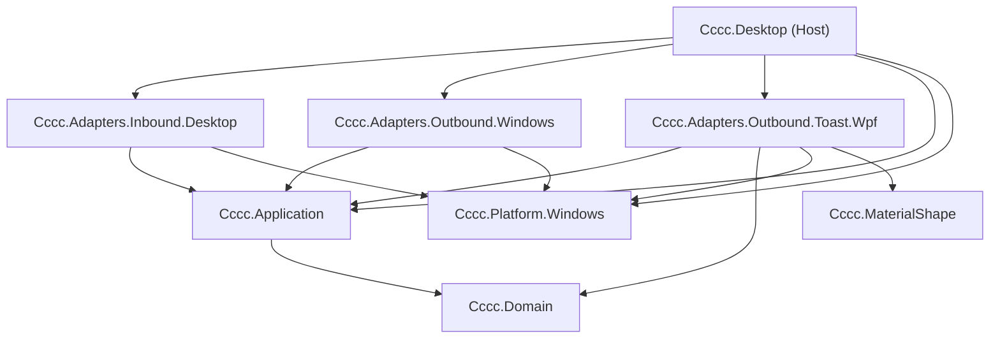

# Repository Architecture & Agent Guidelines

This repository follows a strict hexagonal architecture (`Cccc.Domain` -> `Cccc.Application` -> `Cccc.Adapters.*` -> `Cccc.Desktop`). Keep **business/domain state** strictly separated from **UI/presentation state**, and maintain clear boundaries across every layer and feature.

---

## 1. Project Structure

- **Core & Shared Libraries**
  - `Cccc.Domain` — Pure domain models, state machines, invariants, thresholds, and value objects (e.g., `FeedbackEngine`, `CappedCount`, `ClipboardSequence`, `WindowIdentity`).
  - `Cccc.Application` — Use-case orchestration, inbound/outbound ports, presentation-ready DTOs, and mappers/handlers (e.g., `FeedbackSession`, `FeedbackMapper`, `RecordCopyAttemptHandler`).
  - `Cccc.MaterialShape` — Standalone Material 3 Expressive shape and morphing math library (zero `Cccc.*` or UI framework dependencies).
  - `Cccc.Platform.Windows` — Low-level Win32 P/Invoke and Windows interop primitives (`WindowsNativeMethods`).
- **Adapters & Host**
  - `Cccc.Adapters.Inbound.Desktop` — Inbound desktop input, hotkey, and lifecycle adapters (`DesktopInputAdapter`).
  - `Cccc.Adapters.Outbound.Windows` — Outbound Windows system integration (clipboard worker, startup/settings, etc.).
  - `Cccc.Adapters.Outbound.Toast.Wpf` — Outbound WPF toast and taskbar presentation adapter (`ToastPresenter`).
  - `Cccc.Desktop` — Composition root and executable host (`DesktopHost`, `Cccc.exe`).
- **Verification & Tests**
  - `Cccc.Domain.Tests`, `Cccc.Application.Tests`, `Cccc.Adapters.Outbound.Windows.Tests`, `Cccc.MaterialShape.Tests` — Unit and behavior tests per layer.
  - `Cccc.Architecture.Tests` — Automated layer and dependency boundary enforcement (`ArchitectureLayerTests`).
  - `Cccc.Presentation.Verification` — Offscreen rendering, animation, taskbar, material, shape checks, and live WPF preview host.
- **Tooling & Assets**
  - `build.ps1` — Solution build, packaging to `artifacts/build/`, test/presentation checks (`-CheckQuality`, `-CheckAnimation`, `-CheckTaskbar`, `-CheckMaterial`, `-CheckShape`), and cleanup (`-Uninstall`, `-Deep`).
  - `assets/` — Application icons, manifest, and embedded font resources (`assets/fonts/`).
  - `preview/shape/` — Lit/esbuild web preview for shape math.
  - `tools/` — Helper scripts (e.g., `generate-shape-goldens.mjs`).

---

## 2. Architecture & Dependency Rules

The following assembly isolation rules are enforced by `Cccc.Architecture.Tests`:
- `Cccc.Domain` MUST depend on nothing outside itself (no `Cccc.Application`, `Cccc.Adapters.*`, `Cccc.Desktop`, `Cccc.Platform.*`, or UI frameworks).
- `Cccc.Application` MUST depend only on `Cccc.Domain`.
- `Cccc.MaterialShape` MUST reference no `Cccc.*` assembly and no UI framework.
- Adapters (`Cccc.Adapters.Inbound.Desktop`, `Cccc.Adapters.Outbound.Windows`, `Cccc.Adapters.Outbound.Toast.Wpf`) MUST NOT reference each other or `Cccc.Desktop`.
- No production project may reference `Cccc.Desktop`.

---

## 3. Boundary Between Business State and UI State

- **Domain Layer (`Cccc.Domain`) — Business Rules & Invariants**
  - Owns all business state machines, domain invariants, thresholds, capping/overflow rules, and domain value objects (e.g., `FeedbackEngine`, `CappedCount`, `ClipboardSequence`, `WindowIdentity`).
  - Any rule about *what* a value means or *how* it is bounded/formatted by business policy (such as arbitrary count caps like `9+`, `99+`, `999+`, `3+`, `33+`, or title selection) MUST live in `Cccc.Domain`.

- **Application Layer (`Cccc.Application`) — Use-Case Orchestration & Boundary Mapping**
  - Coordinates domain models and ports, and maps domain objects into presentation-ready DTOs (`FeedbackView`, `CopyFeedbackSignal`) via mappers/handlers (`FeedbackMapper`, `RecordCopyAttemptHandler`).
  - Outbound UI adapters should receive ready-to-render fields (e.g., `CountText`) rather than re-computing business rules.

- **UI / Outbound Adapters (`Cccc.Adapters.Outbound.Toast.Wpf`, etc.) — Pure Presentation State**
  - Owns **only** UI-lifecycle and rendering state: window handles (`HWND`), WPF dispatcher timers, animation frames/easing progress, DPI scaling, theme brushes, font bindings, and element layout/visibility.
  - MUST NOT hardcode business thresholds (e.g., `> 99`), business clamping, or domain policy branching. UI code may add purely visual decoration (such as a multiplier glyph prefix `"×"`) and measure/arrange controls.

---

## 4. Pre-Edit Check for UI Changes

Before adding conditional logic or formatting inside any `Cccc.Adapters.*` file:
1. Ask whether the rule changes *business meaning* (e.g., limits, thresholds, state transitions, domain text).
2. If yes, model it in `Cccc.Domain` first, cover it with `Cccc.Domain.Tests`, map it in `Cccc.Application`, and let the UI adapter passively render the result.

---

## 5. Development Workflow Requirements

- **Milestone-Batched Build & Test Execution**
  - Do **not** run builds or tests frequently after every small edit. Reject the endless `"small edit -> test -> small edit -> test"` loop that slows down overall development velocity.
  - Complete one or more coherent milestones (or a full vertical slice across layers) first, then run unified build and test verification (`dotnet test Cccc.sln -c Debug --nologo`, `pwsh ./build.ps1`, and relevant `-Check*` flags when presentation changes), and diagnose/fix any errors together in a consolidated pass.

- **Clear Feature Responsibilities & Boundaries**
  - Always ensure every feature, module, and layer has crisp, unambiguous responsibilities and boundaries.
  - Before writing code, identify which layer owns each part of the feature (Domain invariant vs. Application orchestration/port vs. Adapter I/O/rendering vs. Desktop composition).
  - Keep ports/interfaces minimal and single-purpose. Never leak Win32, WPF, or I/O details into `Cccc.Domain` or `Cccc.Application`, and never duplicate domain rules inside adapters.
