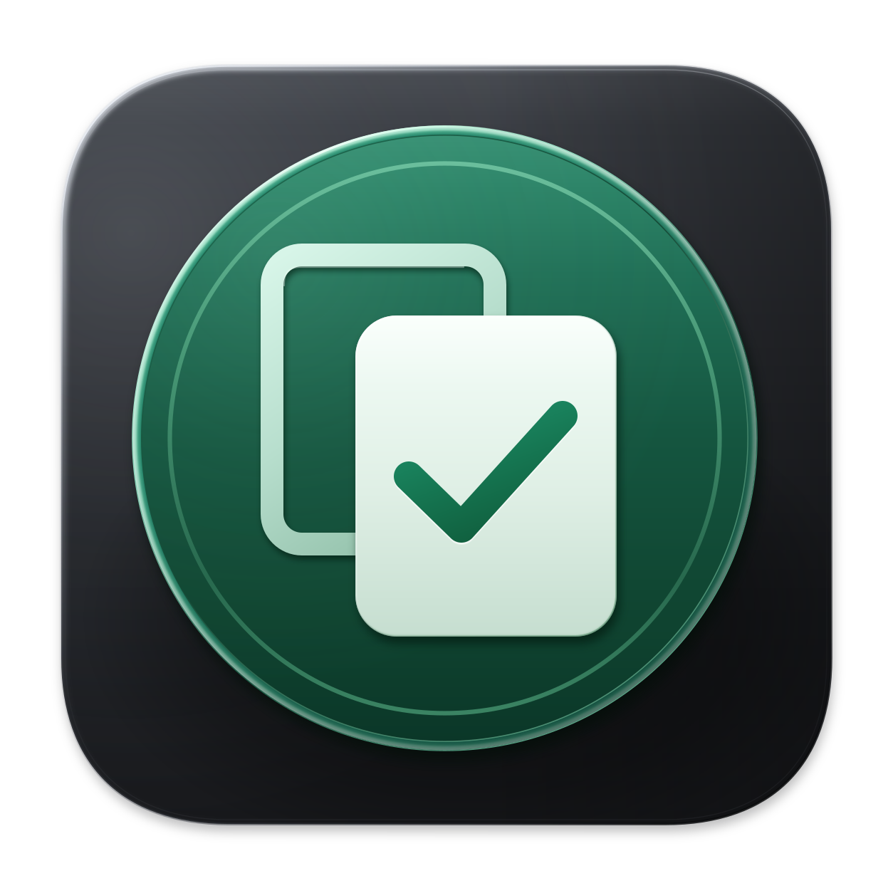

  

# Cccc

一款 Windows 复制反馈工具。

按下 **Ctrl+C** 后，Cccc 会显示提示卡片，帮助你确认复制结果。卡片可以显示内容预览；连续复制时，会显示次数，并通过文字变化和动画提供反馈。

> 演示媒体仍为上一版整卡弹跳；当前版本改为徽章形变，参数与录屏检查见[形状引擎说明](docs/shape.md)。

[观看完整演示 · 约 11 秒](docs/media/demo.mp4)

## 复制反馈

首次复制时，卡片淡入。继续复制时，徽章会沿着 Material 3 Expressive 形状序列连续变形，每次旋转 45°；卡片可见期间，徽章还会以约 45°/秒缓慢自转，计数器同时短暂放大后恢复。卡片本身不再缩放，动画只发生在徽章这一小块区域。停止操作后，卡片自动淡出，徽章回到初始角度。

形状与动画的实现、数值对拍和视觉检查见[形状引擎说明](docs/shape.md)。

- **内容预览**：显示刚复制的文字或文件信息，可以在托盘菜单中关闭。
- **重复复制计数**：显示连续复制次数，配合不同提示语和弹跳动画。
- **主题适配**：跟随 Windows 浅色或深色模式，支持 Acrylic 材质，也可以切换为不透明背景。
- **托盘设置**：支持暂停提示、显示内容预览、开机自启动和高级材质开关。提示卡片不抢占焦点，也不阻挡鼠标操作。

## 为什么做这个工具

许多应用在执行复制后，没有明显的视觉提示。为了确认复制成功，人们有时会重复按下 Ctrl+C。

Cccc 为这一步补充反馈：显示复制结果，提供简短的内容预览，并记录连续复制次数。它不保存剪贴板历史，也不上传复制内容。

## 外观与日常使用

<table>
  <tr><th>浅色</th><th>深色</th></tr>
  <tr>
    <td></td>
    <td></td>
  </tr>
</table>

Cccc 提供浅色和深色外观，使用连续圆角、Acrylic 背景和淡入淡出动画。文字采用四倍采样绘制，以改善小字号的显示效果。

高级材质可以关闭。系统设置或运行环境不支持材质效果时，程序会使用普通背景，复制提示仍可正常使用。

## 开始使用

在[发行页面](https://github.com/hakanasora/CCCC/releases)查看可用版本。自行构建的方法见[构建指南](docs/building.md)。

2.5.0 首次运行默认使用普通卡片并开启开机自启动。托盘菜单的“提示样式”可切换到实验性的任务栏单行提示，空间不足或自动隐藏时可能遮挡图标或显示在任务栏上方。详见 [2.5.0 说明](docs/releases/v2.5.0.md)。

构建后运行输出目录中的 `Cccc.exe`（需保留同目录的 DLL），然后照常复制即可。右键托盘图标，可以调整以下选项：

- 暂停提示
- 显示内容预览
- 开机自启动
- 高级材质

两种提示样式共用“高级材质”开关。普通卡片可显示完整的内容预览。升级前请先从托盘退出正在运行的 Cccc。

程序适用于 Windows x64，需要 .NET 10 Desktop Runtime（x64）。构建输出为包含 `Cccc.exe` 和依赖 DLL 的文件夹，发布时以文件夹或 zip 分发；使用 self-contained 发布文件夹时无需另装运行时。字体在构建时嵌入，运行时无需安装字体。

## 卸载与清理

Cccc 以绿色文件夹分发，不写入程序目录以外的可执行文件，但会留下两处系统痕迹：

- `HKCU\Software\Microsoft\Windows\CurrentVersion\Run` 中的 `Sandlada.Cccc` 值（开机自启动，默认关闭，可在托盘中开启）
- `%LocalAppData%\Sandlada.Cccc` 中的设置文件

仅删除程序文件夹不会移除这两项，之后登录 Windows 时可能尝试启动已经不存在的位置。请使用下列任一方式卸载：

1. 右键托盘图标，选择“卸载 Cccc…”。确认后程序会移除开机自启动和设置文件并退出，程序文件夹需要自行删除。
2. 退出 Cccc 后运行 `Cccc.exe --uninstall` 静默清理。返回码 `0` 表示完成，`1` 表示有项目未能移除，`2` 表示 Cccc 仍在运行。
3. 开发机可运行 `pwsh ./build.ps1 -Uninstall`，结束正在运行的 Cccc、清理上述系统痕迹和 `artifacts/build`；再加上 `-Deep` 会一并清理各项目的 `bin`、`obj` 目录。

## 项目与许可

项目代码采用 [MIT License](LICENSE)。

卡片文字使用 vivo Sans，计数器使用系统字体 Bahnschrift。vivo Sans 遵循原作者授权，不属于项目的 MIT 许可范围；仓库不包含原始字体文件，构建时需要自行准备。详见[字体与第三方说明](docs/third-party.md)。

[2.4.6 历史使用方法](docs/usage-v2.4.6.txt)、[构建步骤](docs/building.md)和[2.4.6 历史设计参数](docs/design-v2.4.6.json)见仓库中的相关文档。
